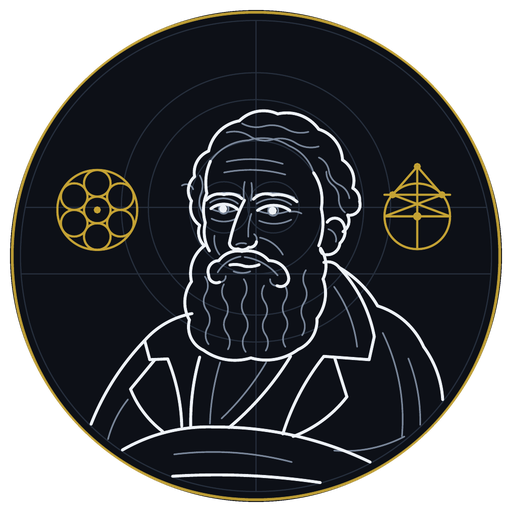

<a href="https://geometor.github.io/steiner/"></a>

# GEOMETOR • steiner

**Visit the Online Archive:** https://geometor.github.io/steiner/

<p align="center">
  <a href="https://geometor.github.io/steiner/"></a>
</p>

**Jakob Steiner • Die geometrischen Constructionen • semantic digital archive**

## Mission

`geometor/steiner` is part of the interconnected [GEOMETOR](https://geometor.com) semantic digital archive. Jakob Steiner proved the profound Poncelet–Steiner theorem: that every Euclidean compass-and-straightedge construction can be carried out using an unmarked straightedge alone, provided a single fixed circle with its center is given in the plane. Within this archive, Steiner's classic 1833 treatise is liberated from isolated print bounds into addressable semantic units, calibrated theme-adaptive vector diagrams, primary-source folio provenance, and exact symbolic algebra across the GEOMETOR corpus.

## Books in This Archive

- [Geometrical Constructions](https://geometor.github.io/steiner/constructionen_1833/) — *Die geometrischen Constructionen, ausgeführt mittelst der geraden Linie und Eines festen Kreises* (Jakob Steiner, 1833), establishing straightedge-only geometric constructions using harmonic pencils, parallel chords, and a single fixed auxiliary circle.

## Repository Contents

- `docsrc/` — Sphinx Book Codex source tracks, scholarly apparatus, and bibliography compiled by [PHOTON publish](https://github.com/photon-platform/publish).
- `resources/` — Primary source German editions, citation registries, and figure manifests.
- `src/geometor/steiner/` — Exact symbolic geometry algorithms, Poncelet–Steiner construction engines, and CLI tools.

## Local Build & Verification

```bash
publish build
uv run --no-sync pytest
```
## Part of the GEOMETOR Knowledge Archive

Explore all **74 Book Codices** and **11 Mathematical Catalogs** at https://geometor.com/books/.
