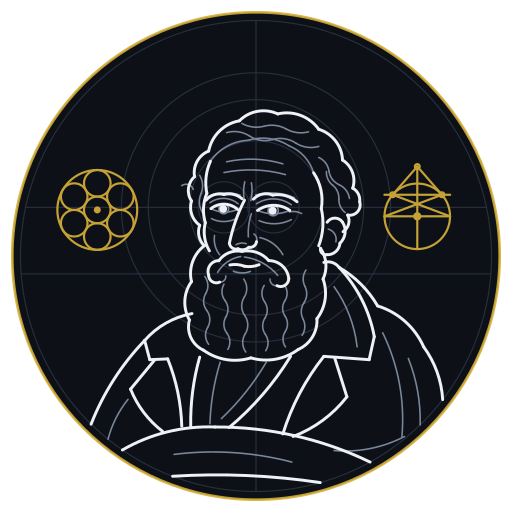

:site_title: Jakob Steiner

.. container:: author-overline

   semantic digital archive • the works of

=============
Jakob Steiner
=============

**Jakob Steiner** (1796–1863) answered a startling question with crystalline clarity: *how little machinery is needed to build all of Euclidean geometry?* In his classic 1833 treatise, Steiner proved that an unmarked straightedge alone suffices for every ruler-and-compass construction—so long as a single fixed auxiliary circle and its center are drawn on the page. This digital archive presents his four-track Book Codex paired with calibrated archival plates, folio scans, and exact SymPy straightedge constructions.

Books in This Collection
------------------------

.. container:: home-book-hero

   .. container:: home-book-thumb

      .. image:: constructionen_1833/chapter_02/sec_13/0045.g1.svg
         :alt: Fig. 16 — Four Axes of Similitude of Three Circles from Steiner § 13
         :target: constructionen_1833/index.html

   .. container:: home-book-body

      .. rubric:: Berlin · 1833 · 3 Chapters + Appendix · 4 Synchronized Tracks

      **Geometrical Constructions (*Die geometrischen Constructionen*)** — Steiner's complete 1833 monograph across **51 leaf pages** and **26 calibrated diagrams**, advancing from harmonic pencils and centers of similitude to the Poncelet–Steiner theorem and 22 appendix problems solved without a compass.

      .. container:: home-actions

         * :doc:`Open Geometrical Constructions → <constructionen_1833/index>`
         * :doc:`Chapter I: Harmonic Pencils → <constructionen_1833/chapter_01/index>`
         * :doc:`Chapter III: Fixed-Circle Method → <constructionen_1833/chapter_03/index>`

Key Features
------------

.. container:: home-feature-grid

   .. container:: home-feature-card

      **Four Synchronized Tracks**

      Navigate seamlessly between the 1833/1895 German primary text, faithful English translation, concise analytical summaries, and scholarly concordance notes.

   .. container:: home-feature-card

      **26 Calibrated Copperplate & SVG Plates**

      Original copperplate extractions sit beside theme-adaptive ``.euclid-graphic`` vector reconstructions tracing parallels, similitude axes, and radical centers.

   .. container:: home-feature-card

      **Exact SymPy Straightedge Engine**

      Inspect machine-verified Poncelet–Steiner constructions in ``geometor.steiner.constructions`` and executable :doc:`Demos <demos/index>`.

Reference & Project
-------------------

.. container:: home-columns

   .. container:: home-col

      .. rubric:: Scholarly Apparatus

      * :doc:`People <people/index>` — Profiles of Jakob Steiner, Lorenzo Mascheroni, Jean-Victor Poncelet, and cited geometers
      * :doc:`Bibliography <bibliography>` — Primary 1833 Dümmler and 1895 Ostwald's Klassiker editions
      * :doc:`Glossary <glossary>` — Bilingual German/English terms of harmonic conjugates, similitude, and polarity

   .. container:: home-col

      .. rubric:: About This Project

      * :doc:`About <about/index>` & :doc:`Using This Edition <usage/index>` — Scope, scriptorium provenance, and reading guide
      * :doc:`Demos <demos/index>` & :doc:`Python Modules <modules/index>` — Straightedge algorithms and API reference
      * :doc:`Project Log <log/index>`, :doc:`Todos <todos/index>` & :doc:`Changelog <changelog>` — Development records and release history

.. toctree::
   :maxdepth: 2
   :hidden:

   constructionen_1833/index
   people/index
   bibliography
   glossary
   about/index
   usage/index
   demos/index
   modules/index
   log/index
   changelog
   todos/index
